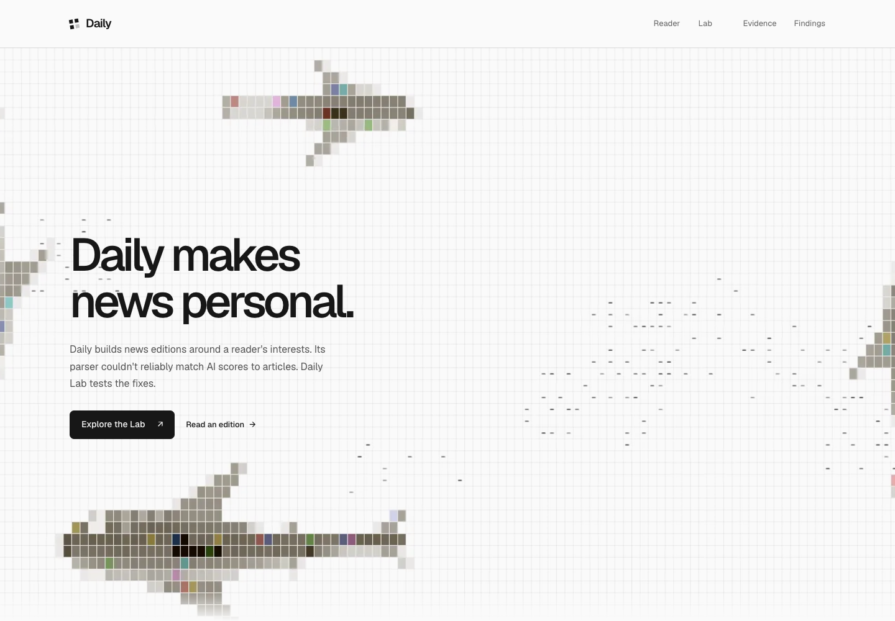
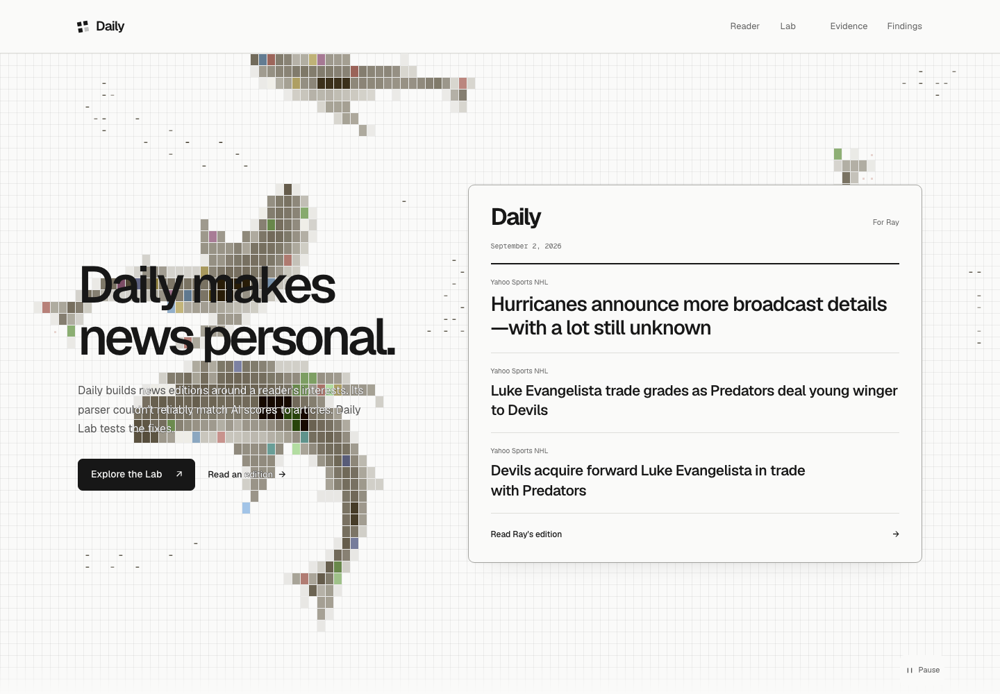
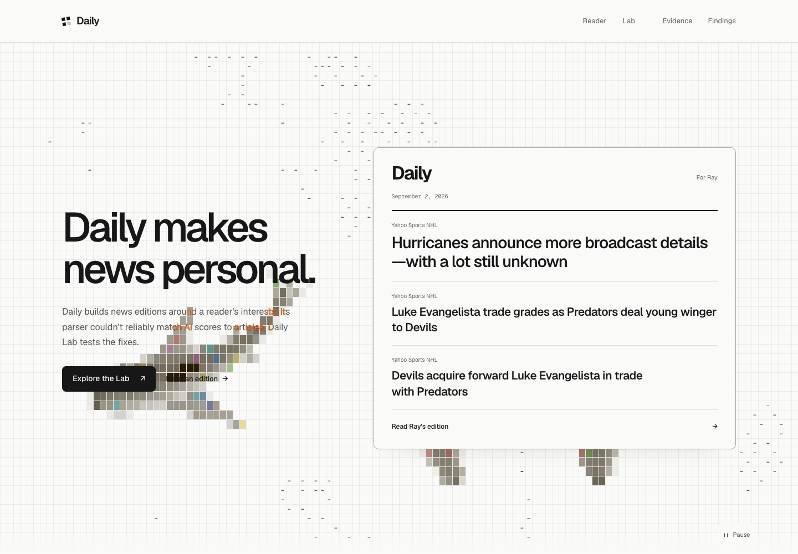
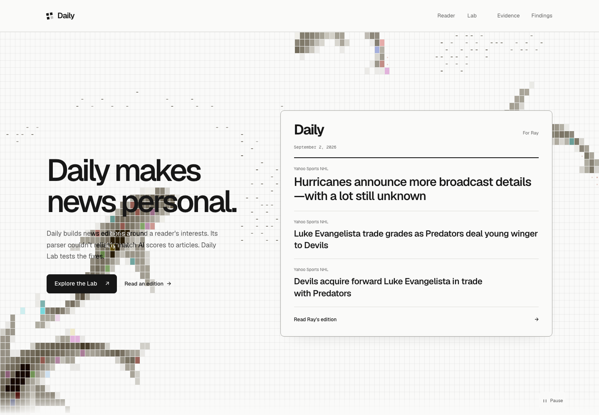
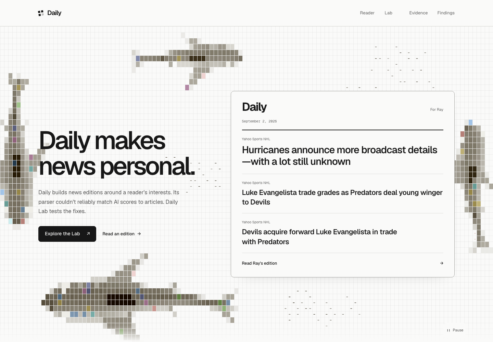
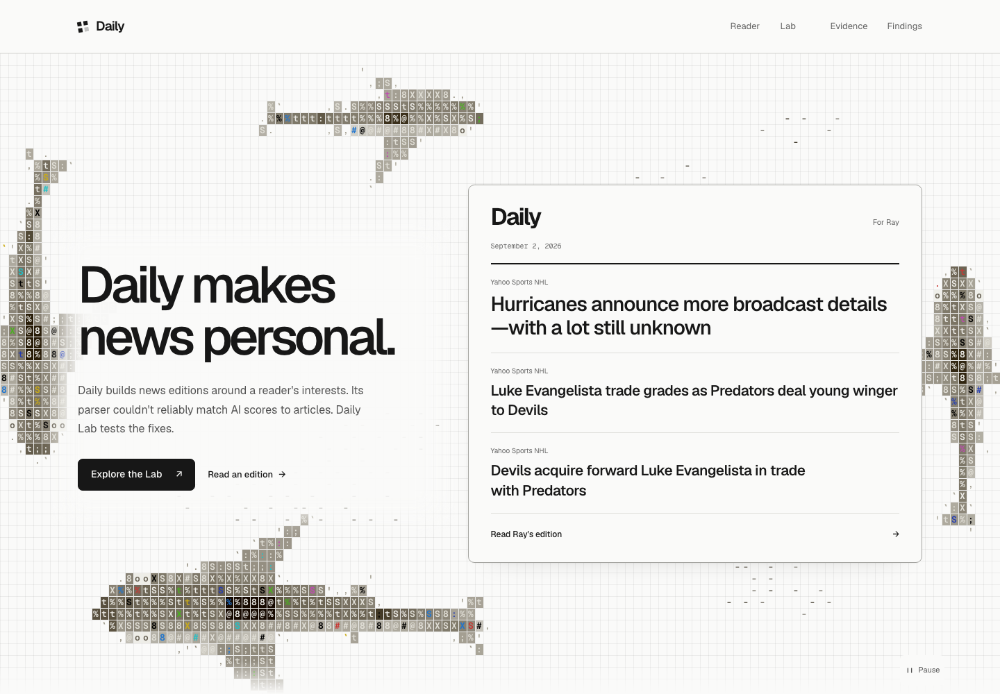
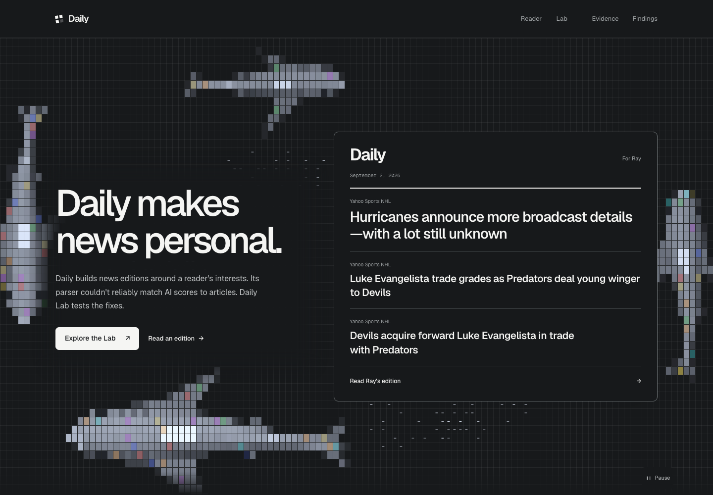
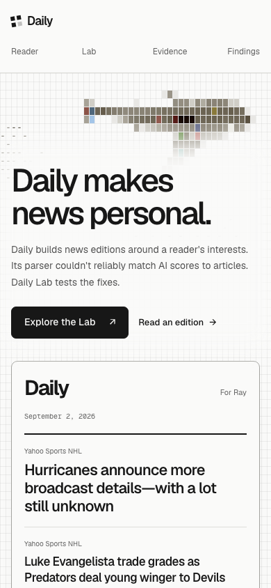
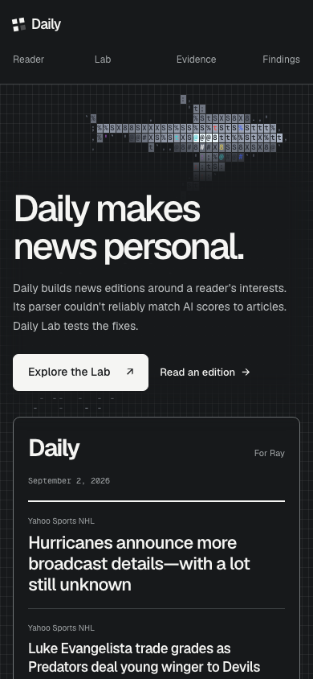
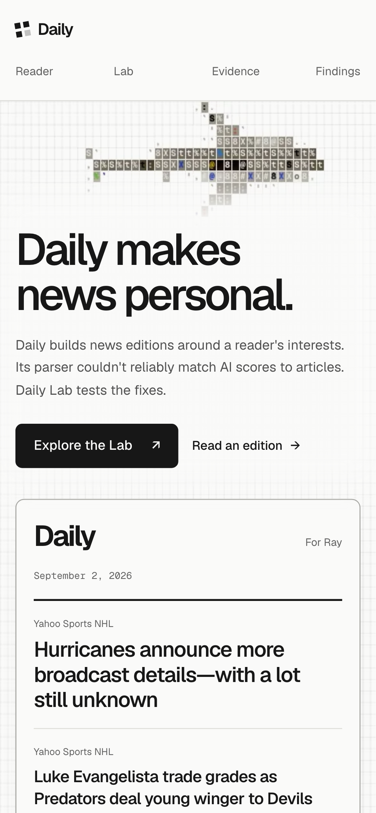

# Full-screen ocean preview

## Neutral interface and open hero

[Current preview](https://daily-espf32wrl-mmarufovs-projects.vercel.app), runtime `5c7b6fee`, deployment `dpl_E9EF4mXxmM3GrmNXwJqng71Lzgoy`.

Removed the hero edition card. The copy stays in its existing column; the Reader link remains. White overlap lettering, shark sizes and the unbacked text treatment are unchanged. Shared surfaces, text selection, link accents, chip hover, disclosure marks and focus states now use neutral colors. Status colors still identify outcomes in the evidence.

Typecheck, production build and 355 unit tests passed, with one existing skip. Shark and text-overlay checks passed in 46 default-project cases and 16 desktop WebKit cases, with six existing skips. All five routes were captured at 1440px and 390px in both themes: no overflow or page errors, and neutral selection colors on every route.

[Mobile](assets/fullscreen-ocean/neutral-mobile.png) · [Text selection](assets/fullscreen-ocean/neutral-selection.png)

PR #112 remains draft. No production release or Sandbox execution was submitted. The preceding white version with the edition card is preserved at `c20d9c7b`.

## White lettering with the edition card

Earlier preview: [white paragraph and Reader lettering](https://daily-ffsu8yz4w-mmarufovs-projects.vercel.app), runtime `53eb681d`, deployment `dpl_AWgzpbdCjLt3cJJoGzC4VgbBbMFv`.

The paragraph and the Reader action's label and arrow turn white on visible scene overlap, then restore their original ink over clear water. Both use the same mask behavior. A fine charcoal stroke defines the white lettering. The Reader destination, native focus, touch target and arrow hover movement are preserved. Shark sizes and the unbacked layout are unchanged.

Typecheck, production build and 355 unit tests passed, with one existing skip. Targeted browser checks covered 46 passing cases across desktop Chromium, mobile Chromium and mobile WebKit, plus 16 on desktop WebKit. Six existing skips remain. Checks include immediate overlap on both surfaces, selection, screen-reader text, keyboard/touch navigation to Ray's edition, hover alignment, print, forced colors and inactive sampling. Captures from 320px through 1920px showed no horizontal overflow or page errors.

[Desktop recording](assets/fullscreen-ocean/white-desktop-motion.mp4) · [Mobile recording](assets/fullscreen-ocean/white-mobile-motion.mp4) · [Mobile screenshot](assets/fullscreen-ocean/white-mobile.png)

The orange comparison is saved at `50a14151`. PR #112 remains draft; production is unchanged.

## Earlier orange comparison

[Orange overlap lettering](https://daily-kcrefl5hx-mmarufovs-projects.vercel.app), runtime `abc3bd50`, deployment `dpl_G2GKPSbT4t8Hzav6bYXsCAqTytcU`.

The paragraph reveals warm orange (`#ff7a2d`) on the first visible shaded frame and restores its normal ink over clear water. A fine brown stroke defines the orange glyphs over gray cells. The faint permanent grid is excluded from detection. The unbacked layout, headline, actions, shark sizes and swimming are unchanged.

Exa research used two searches with ten results and three fetched pages. [Michelle Barker's masked hero](https://tympanus.net/codrops/2021/05/04/dynamic-css-masks-with-custom-properties-and-gsap/) demonstrates an alternate text layer with a moving mask, hidden from screen readers. [Ana Tudor's analysis of Mandy Michael's text effect](https://css-tricks.com/methods-contrasting-text-backgrounds/) describes a clipped text copy whose color is independent of the background. Daily keeps its existing sampler and clips a single orange copy to visible scene content.

Typecheck, production build and 355 unit tests passed, with one existing skip. Preview browser checks: 43 passed across the default Chromium/WebKit projects; 15 passed on desktop WebKit. Six existing skips remain. Tests verify orange on the first sampled pale, gray and bright frame, clearing over empty water, selection, print, forced colors and inactive sampling. Captures from 320px through 1920px show no horizontal overflow or page errors.

[Desktop recording](assets/fullscreen-ocean/orange-desktop-motion.mp4) · [Mobile recording](assets/fullscreen-ocean/orange-mobile-motion.mp4) · [Mobile screenshot](assets/fullscreen-ocean/orange-mobile.png)

The preceding black/white version is saved at `d0dcdc35`. PR #112 remains draft; production is unchanged.

## Earlier black and white comparison

[Adaptive paragraph contrast](https://daily-jwblgdw5u-mmarufovs-projects.vercel.app), runtime `caaac412`, deployment `dpl_BGsJQsjmDVZEjbELTpR16xZnC2YZ`. The owner accepted the unbacked composition. Only the paragraph beginning "Daily builds news editions" changes color over the swimming scene. The headline, actions, shark sizes and layout remain unchanged.

The original text color stays where contrast is sufficient. Small clipped overlays supply black or white lettering over difficult cells. They preserve native text rendering, selection and a single screen-reader copy. Sampling covers the paragraph only and runs with the existing scene paint. Pause, hidden tabs and offscreen playback stop the work; reduced motion uses the poster.

[Desktop recording](assets/fullscreen-ocean/adaptive-desktop-motion.mp4) · [Mobile recording](assets/fullscreen-ocean/adaptive-mobile-motion.mp4)

Typecheck, production build and 356 unit tests passed, with one existing skip. Preview browser checks: 43 passed across desktop Chromium, mobile Chromium and mobile WebKit; 15 passed in additional desktop WebKit coverage. Six existing skips cover the unsupported observation API and desktop-only layout tests. Checks include light/dark/gray cells, selection, accessibility tree, sampling failure, pause, print and forced colors. Layouts from 320px through 1920px had no horizontal overflow or page errors.

Three cold mobile samples with the conditions below produced LCP of 1080, 1088 and 1024ms; CLS was 0.000146 in each. Offscreen drawing and text sampling both stayed at zero. The contrast model checks all 256 gray levels in both themes. Those checks describe solid samples; the rendered edges also depend on antialiasing and the two-pixel sampling grid.

With 4x CPU throttling over five seconds, the sampler followed 28.9 scene frames per second on desktop and 29.4 on mobile. Pixel readback alone took 0.7ms and 0.6ms at p95, respectively.

The exact preceding unbacked version is saved at `26e11fd2`. PR #112 remains draft, with production unchanged.

## Earlier comparisons

[Text backing removed](https://daily-h8my0p4l7-mmarufovs-projects.vercel.app), runtime `9eee51b2`. The only site change from `653be1b0` is deletion of the `.hero-copy::before` rule. Build and light/dark desktop/mobile checks passed; the original CSS remains in that baseline commit for exact restoration.

The backed version and its checks follow.

Reviewed October 28, 2026. Runtime revision: `48b2f335`. Base: `d956b2a9`.

[Open the preview](https://daily-3uzd39yjz-mmarufovs-projects.vercel.app). Deployment: `dpl_HGYinuEqzAgGN21cFi5Pe889k6VF`. Production remains on the base revision.

The hero now fills the desktop opening. Its existing copy, actions and edition sit over the upstream shark renderer, with open water above and below. Mobile keeps the same content order and grows with the text. The sharks use shaded color cells without letters or symbols; swimming and fish are unchanged.

## Recordings

| Daily | Reference |
| --- | --- |
| [Desktop, 15 seconds](assets/fullscreen-ocean/desktop-motion.mp4) | [Creator's original recording](https://designeer.xyz/finds/stackedlol-2112257760628986188) |
| [Mobile, 15 seconds](assets/fullscreen-ocean/mobile-motion.mp4) | [Source at the pinned revision](https://github.com/stackedlol/ascii-sharks/tree/a0074c16a106f0abc665fe9712ca445f8f98ad8e) |

| Mobile | Mobile dark theme |
| --- | --- |
|  |  |

## Checks

- Typecheck, production build and artifact validation passed. Re-exporting all artifacts left the committed data unchanged.
- Unit tests: 346 passed, one existing skip.
- Full browser suite on `60d1e340`: 314 passed, seven skipped. Covers desktop Chromium, mobile Chromium and mobile WebKit with mocked runner endpoints.
- Color-cell update on `48b2f335`: 28 ocean checks passed across the default projects, five skipped. Additional desktop WebKit ocean checks: 10 passed, one existing skip. The browser check rejects text glyphs in shark rendering. Chromium and WebKit captures confirm the color tiles, pause/resume and static fallback.
- Reviewed 320, 390, 430, 820, 844, 1440 and 1920px widths, light/dark themes and a 390px-high landscape window. No horizontal overflow or page errors appeared.
- Doubling hero text size at 390px kept both Chromium and WebKit within the viewport. The section grew to about 2116px. At 1440px it grew to about 1193px.
- Pause/resume, resize, hidden tabs, printing, reduced motion, unavailable canvas, disabled scripts, forced colors and keyboard actions passed. The ocean stopped drawing while offscreen, including after resize.
- The math, species and simulation modules match the pinned source after removing the documented TypeScript directive. The renderer has a documented color-cell option. The MIT license is retained in the source and public assets.

Cold mobile measurements used Pixel 7 emulation at 412x839, disabled cache, 4x CPU throttling, 1.6Mbps down, 750Kbps up and 150ms latency. The preview toolbar was blocked. Three samples on `60d1e340`:

| Sample | LCP | CLS | Offscreen draw calls |
| --- | ---: | ---: | ---: |
| 1 | 1080ms | 0.000146 | 0 |
| 2 | 1124ms | 0.000146 | 0 |
| 3 | 1064ms | 0.000146 | 0 |

These are lab measurements. Browser coverage used Playwright engines; physical phone and trackpad checks were unavailable.

## Existing unsupported-browser issue

Removing `IntersectionObserver` still breaks the existing parser story on production. Its browser test remains marked `fixme`; the ocean itself falls back to its poster when observation APIs are missing. The other browser skips are desktop-only checks on mobile projects.

The parser story, evaluator, backend, data, public routes and homepage copy are unchanged. No Sandbox execution was submitted for this presentation pass.
