# Supporting-page review

Reviewed UI revision: `c6e20d61`. Base: `ce395c0c` (current main).

[Hosted preview](https://daily-ilrwfk6ar-mmarufovs-projects.vercel.app) · [PR #113](https://github.com/mmarufov/Daily/pull/113)

This records the supporting-page review before the approved shark refinements. Release was approved on November 6.

## Approved shark refinement

[Grayscale preview](https://daily-jmhtdbfil-mmarufovs-projects.vercel.app). Both the animated canvas and fallback posters use neutral shading. Build, typecheck and 11 ocean unit tests pass; 38 hosted Chromium/WebKit cases pass with six existing skips. Canvas pixel checks confirm grayscale rendering. Desktop and mobile captures in both themes have no horizontal overflow.

## Removal inventory

| Page | Removed from the initial view | Still available |
| --- | --- | --- |
| Lab | Repeated introduction, idle case grid, standalone walkthrough and criteria sections | Inspect cases, Recorded examples, Grading criteria, Published runs; all published URLs |
| Reader | Live mode checklist and nine repeated fixture previews | Existing profile selector; recording metadata under Inspect recording; requirements in developer documentation |
| Evidence | Full metrics table, glossary, run statistics and fixture results | Native disclosures; existing Summary, Funnel, Stories and query controls |
| Case study | Two repeated examples, repeated interpretations, duplicate provenance link and self-link | More recorded examples, all three traces, identity diagram and interactive guard comparison |

Navigation is Lab, Case study and GitHub. Reader and Evidence remain in the footer and contextual links. The initial supporting-page pass preserved the homepage. The later approved refinement removes its background grid, small fish, wake dots and colored shark accents. Shark sizing, steering, content and layout remain unchanged.

## Verification

- Production build and typecheck pass.
- Unit suite: 355 passed, one existing skip.
- Artifact regeneration produces no changes in `web/public/artifacts`, `web/public/demo` or `web/public/lab-artifacts`.
- Hosted browser suite: 516 passed, eight existing skips across desktop/mobile Chromium and WebKit. Network disconnects interrupted 47 cases; all 47 passed on rerun at the same revision.
- The final fixture-bar alignment adjustment passed all 64 supporting-page browser cases on the final preview. The full suite used `44da9aa9`; the final scoped alignment change and its assertions used `c6e20d61`.
- Chromium captures: 40 views across five routes, 320/390/768/1440px, light and dark. No page errors or horizontal overflow.
- Doubled text: 32 supporting-route views across the same widths and themes, without horizontal overflow. Browser tests also expand disclosures at 320px with doubled text.
- Eight full homepage main-content screenshots are pixel-identical to production. Desktop and two-row mobile header heights match the baseline.
- All three preset submissions retain the complete committed source bytes. The editor moves only its scroll position.
- Routine runner requests are mocked by the existing shared test fixture. No Sandbox submission was made.

Screenshots use reduced motion for a deterministic baseline. The [layout report](supporting-pages/layout-report.json) records dimensions and the homepage comparison. Chromium and WebKit are automated coverage; no separate physical-device session was performed.

The initial browser pass caught WebKit select overflow and its native 23px control height. Scoped select styles now retain native selection behavior with a 44px target. Enlarged text also exposed fixed chart columns and long identifiers, so supporting charts stack their labels and tracks when space is limited, and recording text wraps.

## Initial document height

Values include the unchanged header and footer, with disclosures closed, in the light theme.

| Page | Desktop 1440px, before → after | Mobile 390px, before → after |
| --- | --- | --- |
| Lab | 2480 → 1677px | 3979 → 2342px |
| Reader | 2748 → 1657px | 4653 → 2537px |
| Evidence | 3390 → 1928px | 4938 → 2545px |
| Case study | 2876 → 2512px | 3843 → 3106px |

## Reproduce browser checks

Use the exact preview deployment URL. For a protected preview, provide a Playwright storage-state file with authorized Vercel access. Keep that file outside git.

```sh
cd web
PREVIEW_URL=https://daily-ilrwfk6ar-mmarufovs-projects.vercel.app \
PLAYWRIGHT_STORAGE_STATE=/absolute/path/to/preview-storage.json \
npx playwright test --config playwright.preview.config.ts
```

This configuration starts no local server and includes desktop/mobile Chromium and WebKit. Desktop WebKit uses Option-Tab to reach links when full keyboard access is off.

## Screenshots

<details>
<summary>Lab: desktop, mobile and dark theme</summary>

Desktop

| Before | After |
| --- | --- |
| 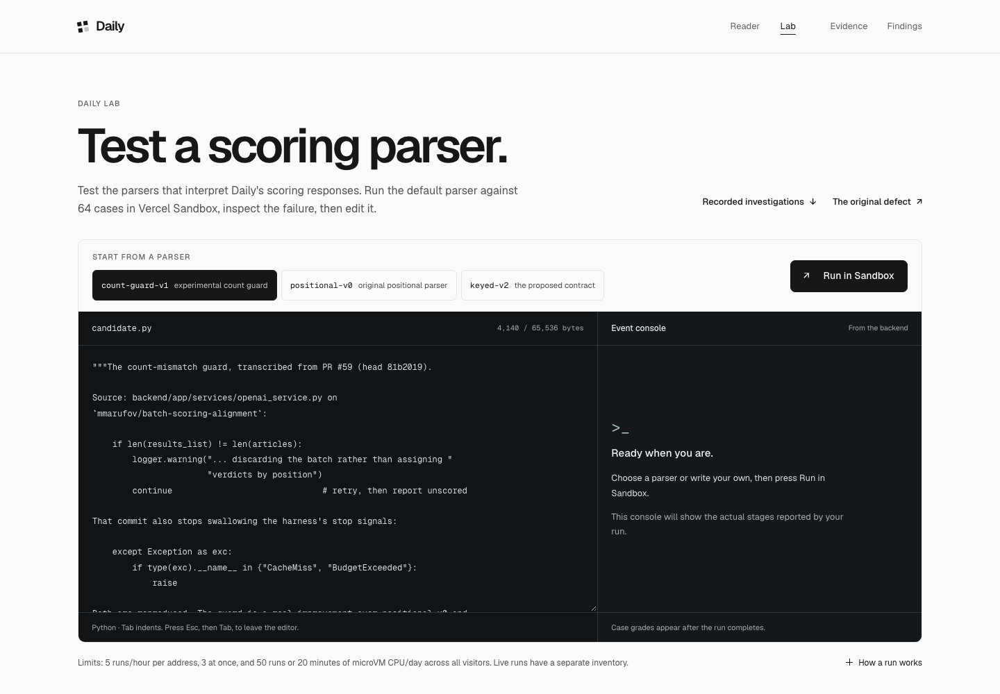 | 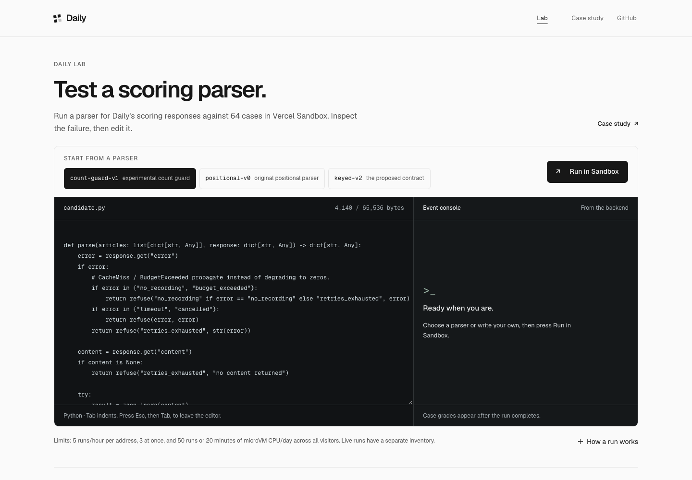 |

Mobile

| Before | After |
| --- | --- |
| 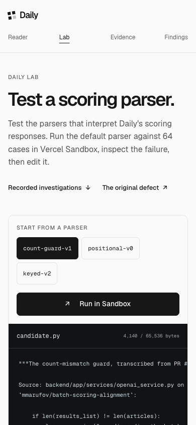 | 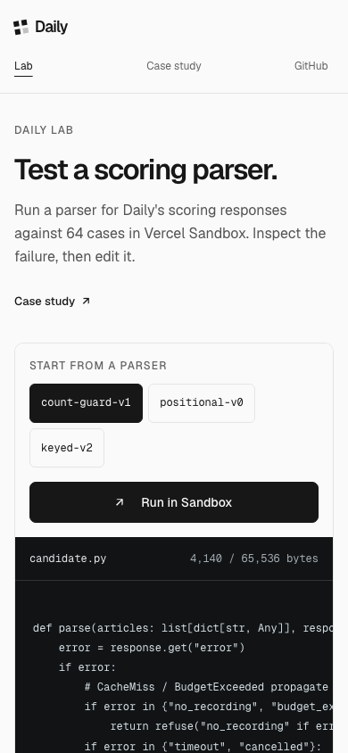 |

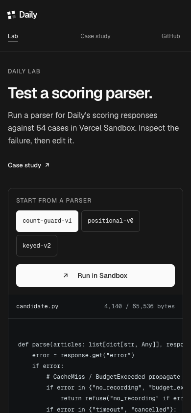

</details>

<details>
<summary>Reader: desktop, mobile and dark theme</summary>

Desktop

| Before | After |
| --- | --- |
| 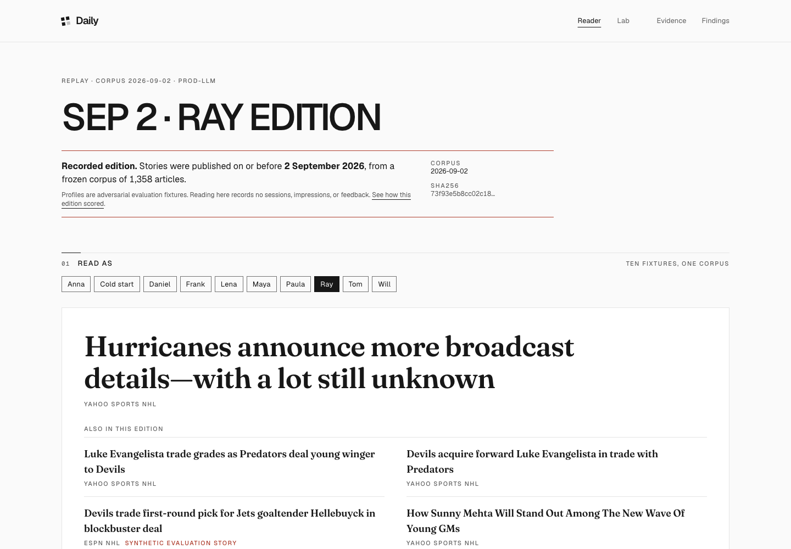 | 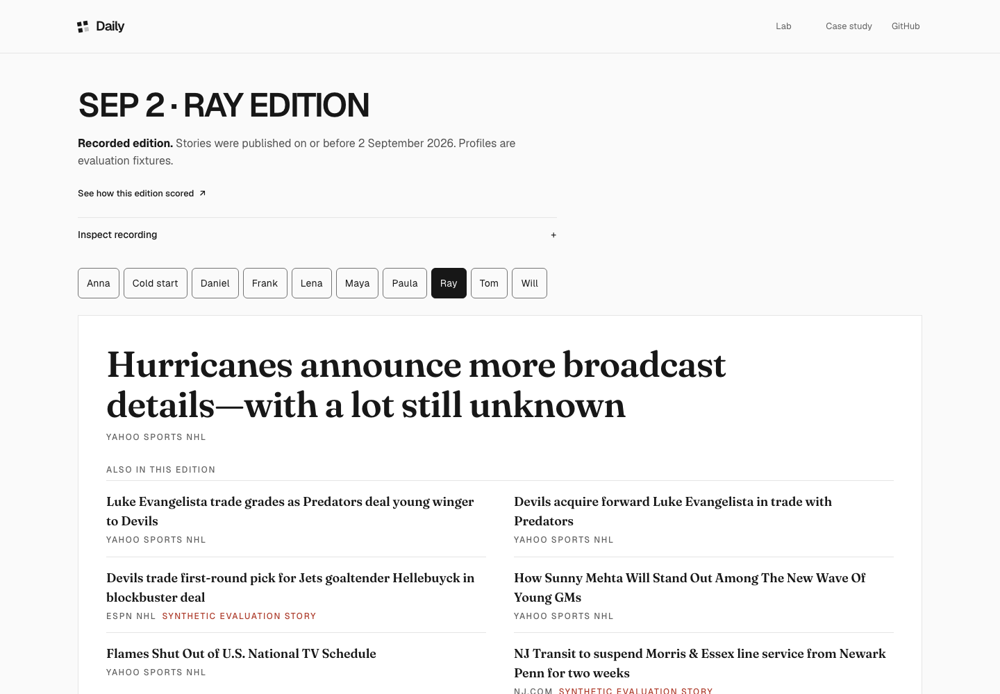 |

Mobile

| Before | After |
| --- | --- |
| 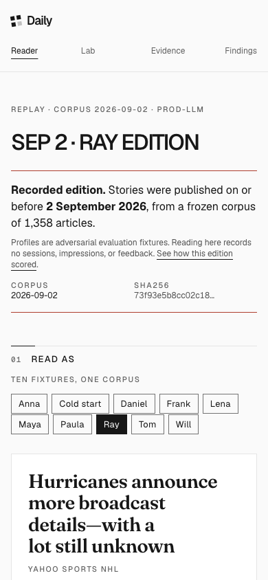 | 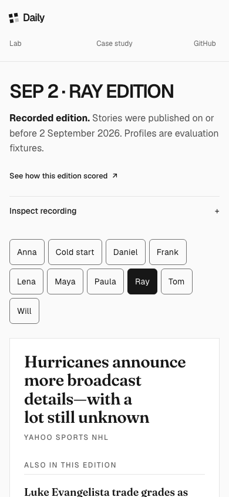 |

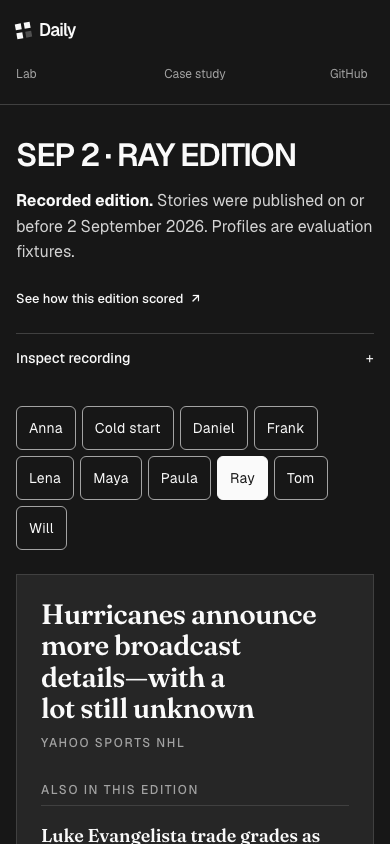

</details>

<details>
<summary>Evidence: desktop, mobile and dark theme</summary>

Desktop

| Before | After |
| --- | --- |
| 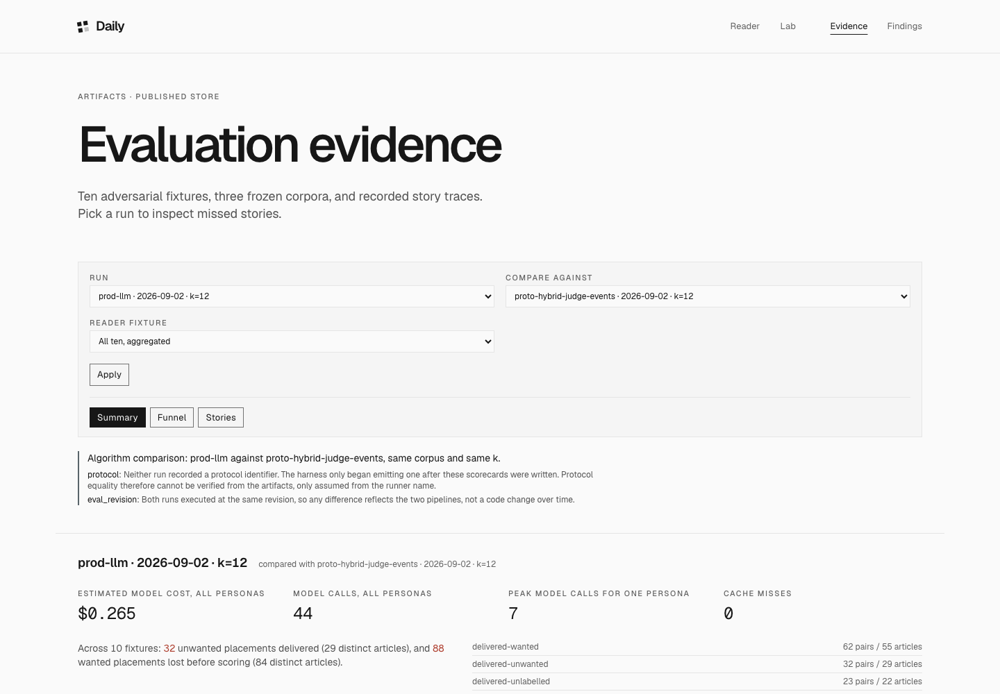 | 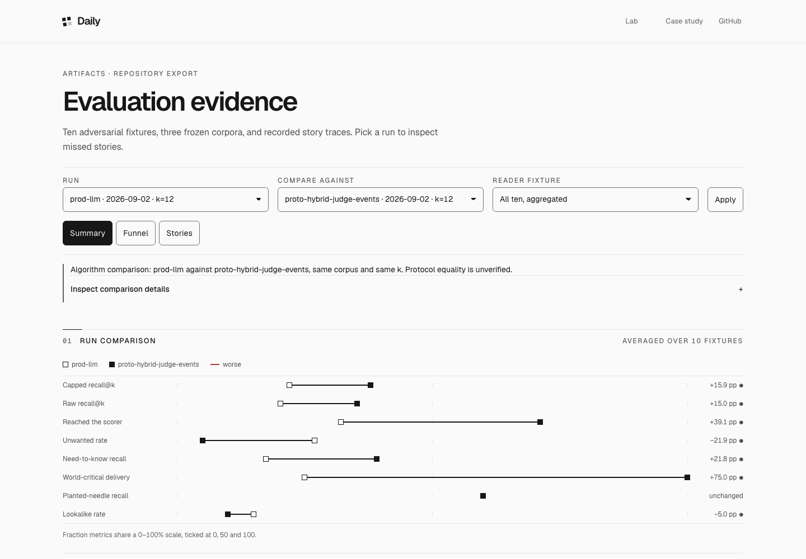 |

Mobile

| Before | After |
| --- | --- |
| 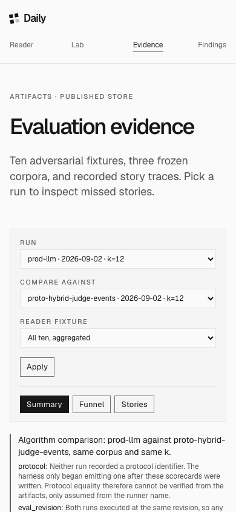 | 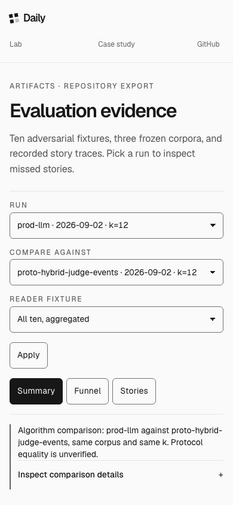 |

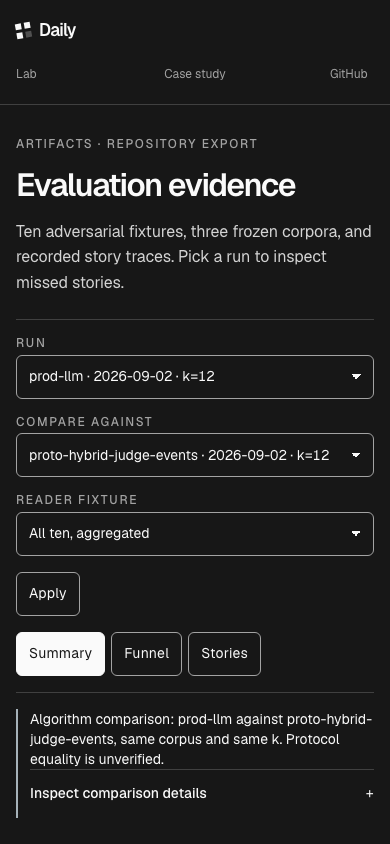

</details>

<details>
<summary>Case study: desktop, mobile and dark theme</summary>

Desktop

| Before | After |
| --- | --- |
| 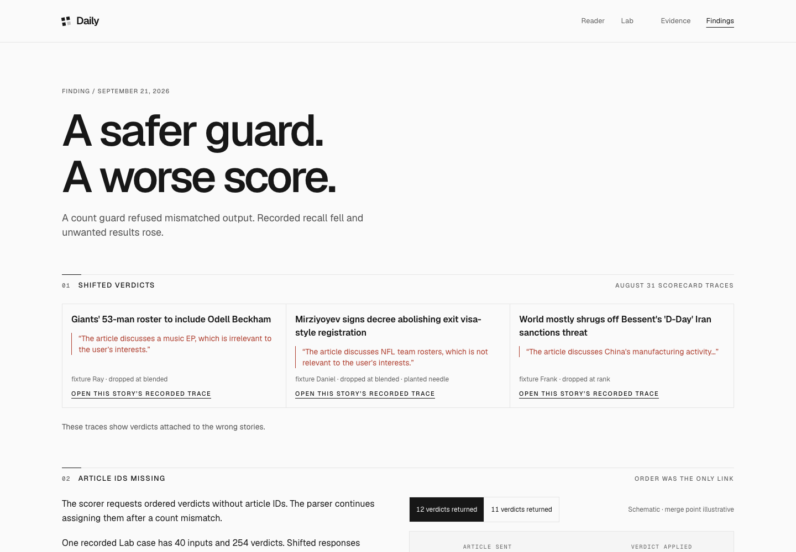 | 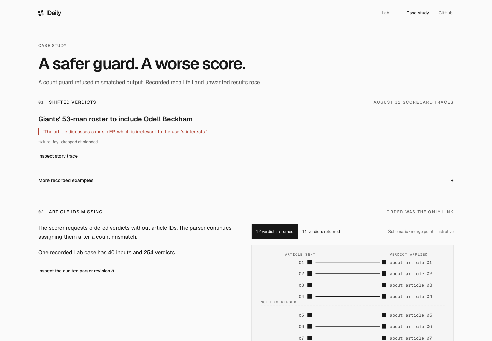 |

Mobile

| Before | After |
| --- | --- |
| 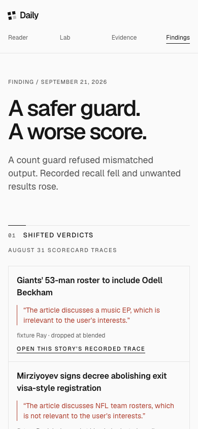 | 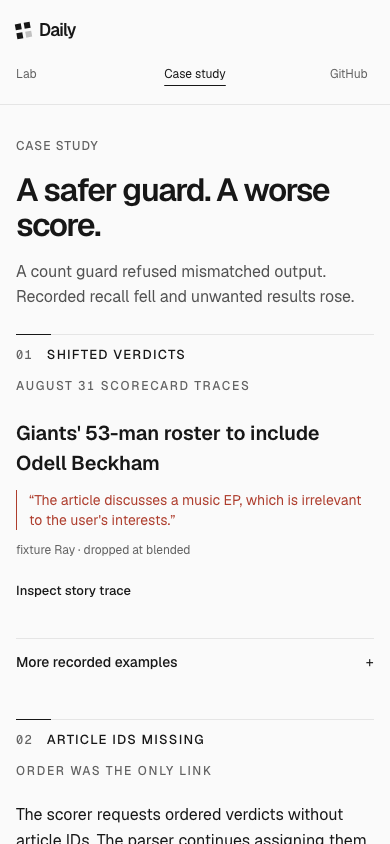 |

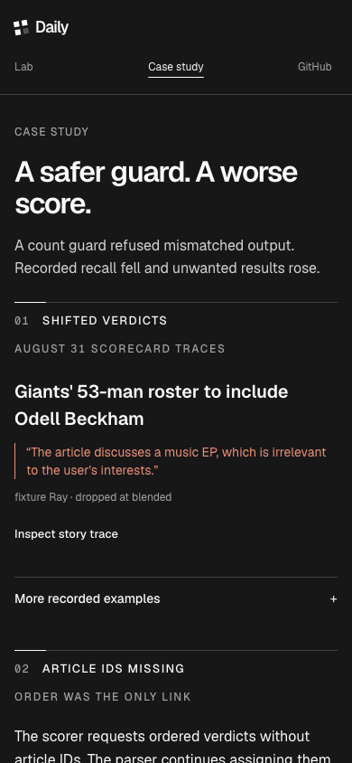

</details>

